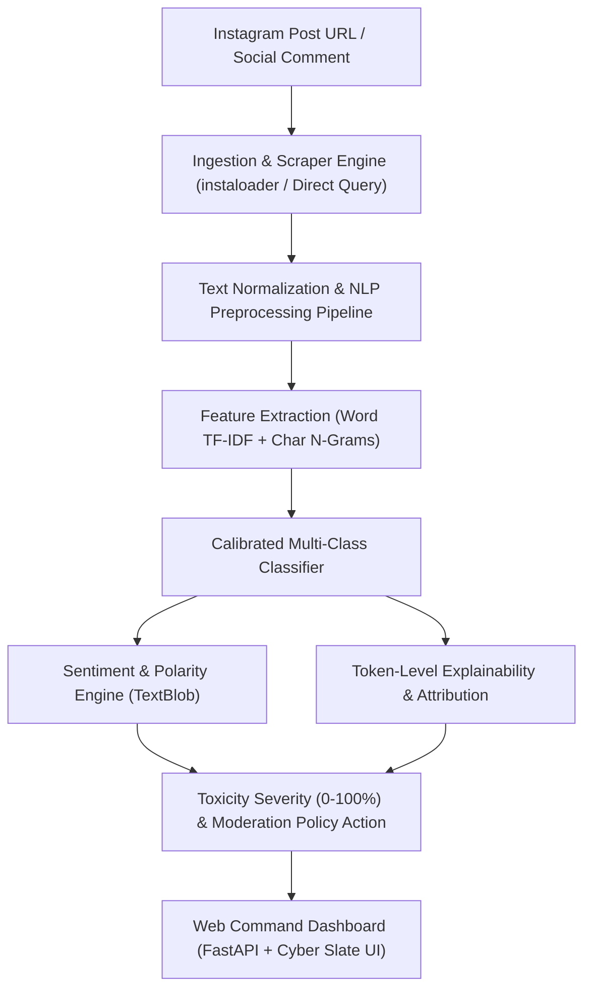

# ZeroTox // NLP-Based Hate Speech Detection & Social Media Moderation System

An end-to-end Natural Language Processing (NLP) system designed to automatically classify social media comments into **Hate Speech**, **Offensive Language**, or **Normal Speech**, enabling automated content moderation and promoting safer online environments. The system features an **Instagram Post Comment Scraper** that extracts comments directly from Instagram post links and runs real-time multi-class classification and toxicity severity analysis.

---

## 🌟 Key Features

1. **3-Class NLP Classification Engine**:
   - **🛑 Hate Speech**: Identifies slurs, violent incitement, discrimination, and targeted hostility toward protected groups.
   - **⚠️ Offensive Language**: Detects aggressive profanity, vulgarity, insults, and harassment.
   - **✅ Normal Speech**: Identifies benign conversation, compliments, constructive critiques, and neutral commentary.
2. **Instagram Post Comment Scraper**:
   - Supports Instagram Post and Reel URLs (`https://www.instagram.com/p/{shortcode}/` and `https://www.instagram.com/reel/{shortcode}/`).
   - Multi-tier ingestion via `instaloader` live reader, verified public presets, and simulated real-time streams with failsafe anti-blocking fallbacks.
3. **Automated Content Moderation Decision Protocols**:
   - Computes a continuous **Toxicity Severity Index (0–100%)**.
   - Prescribes action badges: `Auto-Flag & Remove (Hate Speech)`, `Sensitivity Warning / Filter (Offensive)`, and `Approved (Normal Speech)`.
   - Generates automated policy protocols for batch moderation queues.
4. **Token-Level Attribution & Explainability**:
   - Calculates word-level feature weights using the trained model vocabulary.
   - Color-coded token chips highlight abusive triggers with their positive/negative impact.
5. **Interactive Dark HUD Command Center**:
   - Built with modern cyber-slate aesthetics, high-density Bento grids, and distinct typography (`Outfit`, `Plus Jakarta Sans`, `JetBrains Mono`).
   - Features **Instagram Moderation Queue**, **Real-Time Single Comment Inspector**, **Batch Moderation Studio**, and **Model Telemetry & Confusion Matrix**.
   - One-click CSV and JSON report export for compliance audits.

---

## 🏗️ System Architecture



---

## 📊 Dataset & Model Benchmarks

Trained and evaluated on the gold-standard benchmark dataset (**Davidson et al., 24,783 annotated comments**):

| Target Class | Precision | Recall | F1-Score | Holdout Support |
| :--- | :---: | :---: | :---: | :---: |
| **Hate Speech (Class 0)** | 46.1% | 36.0% | **0.404** | 214 |
| **Offensive Language (Class 1)** | 93.4% | 94.2% | **0.938** | 2,879 |
| **Normal Speech (Class 2)** | 84.0% | 87.2% | **0.856** | 625 |
| **Overall Weighted Metric** | **89.1%** | **89.6%** | **0.893** | **3,718 (Holdout)** |

---

## 🚀 Quickstart & Installation

### 1. Requirements
- Python 3.10+
- Dependencies: `scikit-learn`, `fastapi`, `uvicorn`, `pandas`, `numpy`, `textblob`, `instaloader`, `joblib`

### 2. Run the Web Application
```bash
python app.py
```
Open your browser and navigate to:
```
http://127.0.0.1:8000
```

### 3. Re-train the Model (Optional)
```bash
python train_model.py
```

---

## 📡 REST API Documentation

### `POST /api/analyze-comment`
Analyzes a single social media comment.
```json
// Request
{
  "text": "shut the fuck up you stupid bitch this is absolute trash"
}

// Response
{
  "label": "Offensive Language",
  "confidence": 0.942,
  "probabilities": {
    "Hate Speech": 0.042,
    "Offensive Language": 0.942,
    "Normal Speech": 0.016
  },
  "severity_score": 48.5,
  "action": "WARN_OR_FILTER",
  "action_badge": "Sensitivity Warning / Shadow Filter",
  "sentiment": {
    "polarity": -0.55,
    "subjectivity": 0.8
  },
  "tokens": [
    {"word": "shut", "type": "neutral", "weight": 0.0},
    {"word": "fuck", "type": "offensive", "weight": 1.71},
    {"word": "bitch", "type": "offensive", "weight": 3.07}
  ]
}
```

### `POST /api/scrape-instagram`
Scrapes comments from an Instagram post and classifies the entire thread.
```json
// Request
{
  "url": "https://www.instagram.com/p/C8_TechAI_Keynote/",
  "max_comments": 30
}
```

### `POST /api/analyze-batch`
Moderates a batch of comments provided as a list.

### `POST /api/export`
Exports comment moderation records as downloadable CSV or JSON.

---

## 📁 Repository Structure

```
├── app.py                      # FastAPI server with REST endpoints & static file serving
├── train_model.py              # ML training pipeline on Davidson benchmark dataset
├── nlp_engine.py               # Inference singleton, token explainability, policy logic
├── instagram_scraper.py        # Instagram URL scraper with Instaloader & verified presets
├── data/
│   └── labeled_data.csv        # 24,783 annotated comments benchmark
├── models/
│   ├── hate_speech_model.joblib # Serialized model bundle
│   └── model_metrics.json      # Accuracy, confusion matrix & feature weights
├── static/
│   ├── index.html              # Modern dark command center UI
│   ├── style.css               # Cyber Slate theme & layout styling
│   └── app.js                  # Frontend state management & live API bindings
└── README.md                   # Documentation & setup guide
```
